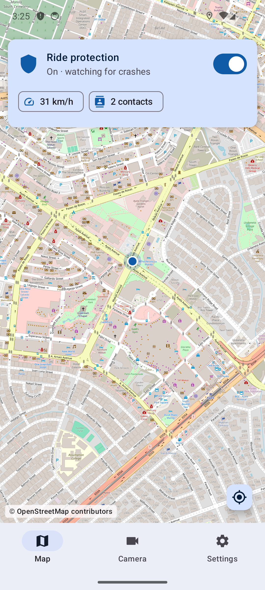
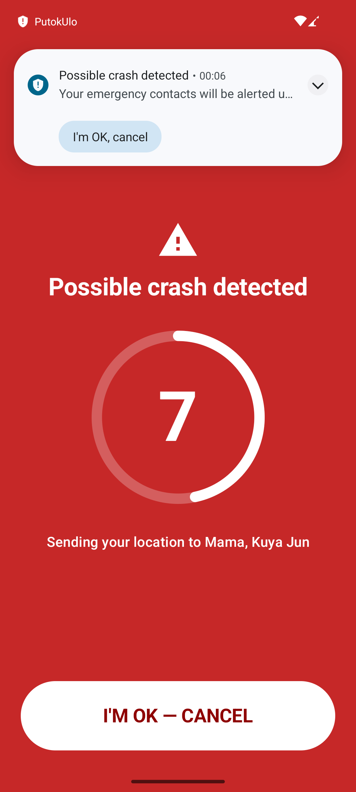
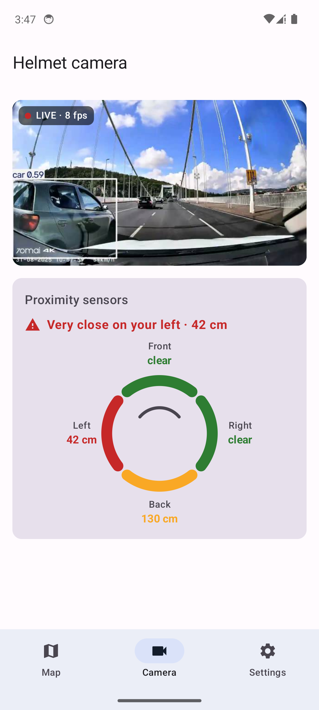

# PutokUlo

A motorcycle helmet safety system:

- **Android app** (`android/`): map with your location, automatic crash detection with the phone's accelerometer
  (SMS with your location to your emergency contacts if you don't cancel), and the live helmet camera feed with
  proximity warnings.
- **Raspberry Pi 4 on the helmet** (`pi/`): streams the camera to the app and beeps when something gets close,
  using 4 HC-SR04 ultrasonic sensors and a buzzer.

| | | |
|---|---|---|
|  |  |  |

## Where to start

- **Pi:** [pi/README.md](pi/README.md) for setup, running and autostart.
  New to wiring? Follow [pi/wiring/WIRING_GUIDE.txt](pi/wiring/WIRING_GUIDE.txt).
- **App:** open the `android/` folder in Android Studio and press Run.

## Getting the code on the Pi

```bash
git clone <this repo's URL> ~/PutokUlo
```

To update it later: `cd ~/PutokUlo && git pull && pi/autostart.sh restart`.
